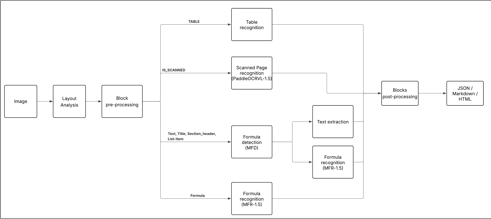

# TexFromPDF

**TexFromPDF** is a free and open source tool that extracts structured content from PDF files. It relies on **PyMuPDF** and several **Deep Learning** models to recognize text, formulas, tables, images and scanned pages, and assembles them into a JSON structure that can be converted to **Markdown** or **HTML**.



## Features

- **Layout analysis**: detection of titles, paragraphs, lists, captions, footnotes, page headers/footers, tables, formulas and images (YOLO trained on DocLayNet).
- **Automatic orientation correction** of pages.
- **Formulas**: inline detection and LaTeX recognition (`$...$` and `$$...$$`).
- **Tables**: structure extraction with merged cell handling (`rowspan` / `colspan`).
- **Scanned pages and areas**: OCR with a vision-language model (PaddleOCR-VL).
- **Images**: extraction as base64-encoded PNG.
- **Exports**: structured JSON, Markdown, HTML.
- **Batch processing**: recursive scan of a PDF folder.
- **Debug outputs**: annotated pages, table, formula and scanned-area images.

## Models

| Model | Role |
|---|---|
| YOLOv12l-DocLayNet (or YOLO26m-DocLayNet) | Layout analysis |
| MFD 1.5 (`pix2text-mfd-1.5`) | Formula detection |
| MFR 1.5 (`breezedeus/pix2text-mfr-1.5`) | Formula recognition (LaTeX) |
| PaddleOCR-VL-1.5 | OCR of scanned areas |

Details in [docs/models.md](docs/models.md).

## Quick start

Requirements: Python 3.12+, NVIDIA GPU recommended (CPU supported).

```bash
git clone git@github.com:cqptomii/TexFromPDF.git
cd TexFromPDF
python -m venv .venv && source .venv/bin/activate   # Windows: .venv\Scripts\Activate.ps1
pip install -r requirements.txt
```

Then place the local models in `models/`:

```
models/
├── layout_detection/yolov12l-doclaynet.pt
└── formula/pix2text-mfd-1.5.onnx
```

The MFR and PaddleOCR-VL models are downloaded automatically from Hugging Face on first run. Full guide: [docs/installation.md](docs/installation.md).

## Usage

### Command line

```bash
python src/texparser.py --pdf_dir ./data/sample_pdfs --output_dir ./output --device cuda
```

| Option | Default | Description |
|---|---|---|
| `--pdf_dir` | required | PDF folder (searched recursively) |
| `--output_dir` | required | Output folder |
| `--device` | `cuda` | `cuda` or `cpu` (automatic fallback to CPU if CUDA is unavailable) |
| `--verbose` | disabled | Detailed logs |
| `--save_md` / `--no-save_md` | enabled | Markdown export |
| `--save_html` / `--no-save_html` | disabled | HTML export |

### Python API

```python
from src.content_extractor import ContentExtractor

extractor = ContentExtractor(pdf_path="data/sample_pdfs/page_010.pdf", output_dir="output", device="cuda")
document = extractor.extract()
```

### Output

For each PDF, an `output/<name>_<timestamp>/` folder is created. It contains `classifications.json`, `extracted_content.json`, the exported Markdown/HTML and the debug images. See [docs/usage.md](docs/usage.md).

## How it works

1. **Rotation**: the orientation of each page is corrected (text analysis, then pixel projection).
2. **Rasterization**: pages are rendered at 450 DPI.
3. **Detection**: YOLO locates and classifies blocks; duplicates are removed; blocks are sorted in reading order.
4. **Extraction** by a dedicated processor:

| Block | Processor | Technique |
|---|---|---|
| Text, title, list, caption… | `TextProcessor` | PyMuPDF text + MFD detection + MFR recognition |
| Formula | `MathProcessor` | MFR |
| Table | `TableProcessor` | `PyMuPDF.find_tables` + cell cleanup |
| Image | `ImageProcessor` | Cropped to base64 PNG |
| Scanned area | `ScannedImageProcessor` | PaddleOCR-VL |

5. **Assembly and export**: `Document` → `Page` → blocks, exported to JSON, Markdown or HTML.

Details: [docs/architecture.md](docs/architecture.md) and [docs/pipeline.md](docs/pipeline.md).

## Project structure

```
TexFromPDF/
├── docs/            # full documentation
├── data/            # sample PDFs
├── models/          # local model weights
├── output/          # generated results
└── src/
    ├── texparser.py              # CLI
    ├── content_extractor.py      # orchestrator
    ├── content_classifier.py     # rotation, rasterization, YOLO detection
    ├── layout_block_processor.py # block routing
    ├── config/                   # configuration
    ├── datamodel/                # Document, Page, block models
    ├── ocr/                      # MFD, MFR, PaddleOCR-VL wrappers
    ├── processors/               # one processor per block type
    └── utils/                    # geometry, scan detection, text
```

## Documentation

| Document | Content |
|---|---|
| [docs/README.md](docs/README.md) | Documentation index |
| [docs/installation.md](docs/installation.md) | Installation and models |
| [docs/usage.md](docs/usage.md) | CLI, Python API, output format |
| [docs/architecture.md](docs/architecture.md) | Architecture and code organization |
| [docs/pipeline.md](docs/pipeline.md) | Step-by-step pipeline |
| [docs/models.md](docs/models.md) | Deep Learning models |
| [docs/datamodel.md](docs/datamodel.md) | Data model and formats |
| [docs/configuration.md](docs/configuration.md) | Settings and configuration |
| [docs/api-reference.md](docs/api-reference.md) | Module reference |
| [docs/extending.md](docs/extending.md) | Extending the project |
| [docs/limitations.md](docs/limitations.md) | Known limitations and improvement ideas |

## Known limitations

The project is under active development. A few points to be aware of before use (full list in [docs/limitations.md](docs/limitations.md)):

- reading order relies on position-based sorting, without column detection;
- only tables detectable by `PyMuPDF.find_tables` are supported;
- the `models/` weights (YOLO and MFD) are not versioned and must be placed manually;
- the repository does not contain automated tests yet.

## License

Distributed under the **GNU GPL v3** license. See the [LICENSE](LICENSE) file.
