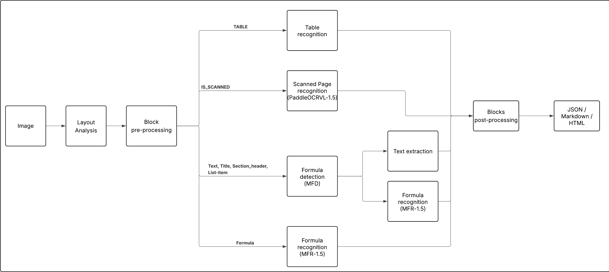

# TexFromPDF Documentation

Welcome to the documentation of **TexFromPDF**, an open source tool that extracts structured content (text, formulas, tables, images, scanned pages) from PDF files.

## Contents

| Document | Content |
|---|---|
| [Installation](installation.md) | Requirements, environment, dependencies, model download |
| [Usage](usage.md) | Command line, Python API, output structure |
| [Architecture](architecture.md) | Overview, code organization, data flow |
| [Detailed pipeline](pipeline.md) | Every processing step, from page rotation to export |
| [Models](models.md) | Deep Learning models, role of each one, weights location |
| [Data model](datamodel.md) | `Document`, `Page` and block classes, JSON/Markdown/HTML formats |
| [Configuration](configuration.md) | `MainConfig`, `ClassifierConfig`, table settings |
| [Module reference](api-reference.md) | Module-by-module and class-by-class description |
| [Extending the project](extending.md) | Add a block type, a processor or an export format |
| [Known limitations](limitations.md) | Known limits, points of attention and improvement ideas |

## Suggested reading path

1. Install the project: [installation.md](installation.md)
2. Run a first extraction: [usage.md](usage.md)
3. Understand what happens: [architecture.md](architecture.md) then [pipeline.md](pipeline.md)
4. Contribute: [extending.md](extending.md) and [limitations.md](limitations.md)

## Overview diagram

