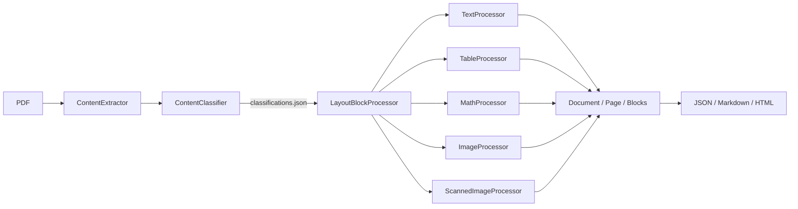
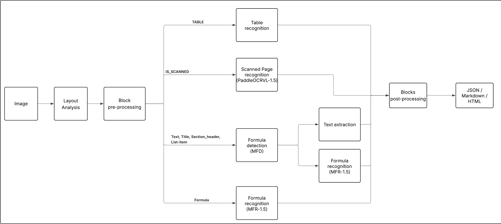
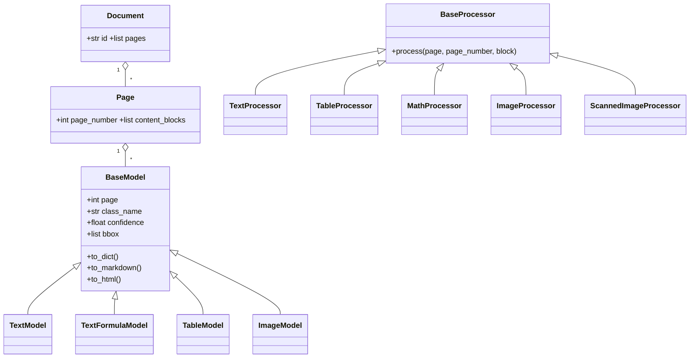

# Architecture

## Principle

TexFromPDF works in **two main phases**:

1. **Classification** (`ContentClassifier`): each page is rasterized, then a YOLO model trained on DocLayNet detects the layout blocks (text, title, table, formula, image…).
2. **Extraction** (`LayoutBlockProcessor`): each block is handed to a specialized *processor* depending on its type. The results are assembled into a data model (`Document` → `Page` → blocks) that can be exported to JSON, Markdown and HTML.

`ContentExtractor` orchestrates both phases and handles the outputs.



The original functional diagram:



## Repository layout

```
TexFromPDF/
├── README.md
├── LICENSE                     # GNU GPL v3
├── requirements.txt
├── .gitignore
├── test.py                     # utility script: extracts pages from a PDF
├── docs/                       # documentation (this folder)
├── data/                       # sample PDFs
├── models/                     # local model weights (not versioned)
├── output/                     # generated results
└── src/
    ├── texparser.py            # CLI entry point
    ├── content_extractor.py    # orchestrator (classification + extraction + export)
    ├── content_classifier.py   # rotation, rasterization, YOLO detection
    ├── layout_block_processor.py   # dispatches blocks to processors
    ├── config/                 # configuration dataclasses
    ├── datamodel/              # Document, Page, block models
    │   └── layout_blocks/
    ├── ocr/                    # model wrappers (MFD, MFR, PaddleOCR-VL)
    ├── processors/             # one processor per block type
    └── utils/                  # bbox geometry, scan detection, text normalization
```

## Module responsibilities

| Module | Role |
|---|---|
| `texparser.py` | Parses CLI arguments, loops over the PDFs, creates one `ContentExtractor` per file |
| `content_extractor.py` | Builds the configuration, creates the classifier and the processor, runs `extract()`, writes JSON/MD/HTML |
| `content_classifier.py` | Corrects page orientation, rasterizes at 450 DPI, runs YOLO, removes duplicates, sorts blocks, produces debug visuals |
| `layout_block_processor.py` | For each block, picks the right processor and aggregates the result into a `Document` |
| `processors/*` | Content extraction for a given block type (see below) |
| `ocr/*` | Wrappers around the recognition models |
| `datamodel/*` | Content representation and conversions (`to_dict`, `to_markdown`, `to_html`) |
| `utils/*` | Cross-cutting helpers |

## Block routing

`LayoutBlockProcessor.process()` picks the processor from `class_name` (lowercased):

| Detected class | Processor | Technique | Produced model |
|---|---|---|---|
| `table` | `TableProcessor` | PyMuPDF `page.find_tables()` + merged cell cleanup | `TableModel` |
| `formula` | `MathProcessor` | Image crop + MFR model (LaTeX) | `TextModel` |
| `picture` | `ImageProcessor` | Area cropped to a base64-encoded PNG | `ImageModel` |
| `scanned-image` | `ScannedImageProcessor` | OCR with PaddleOCR-VL | `TextModel` |
| everything else (`text`, `title`, `section-header`, `list-item`, `caption`, `footnote`, `page-header`, `page-footer`) | `TextProcessor` | PyMuPDF text + inline formula detection (MFD) + recognition (MFR) | `TextModel` |

## Coordinate systems

Three coordinate systems coexist:

- **Image**: pixels of the rasterized page (zoom = 450 / 72 = 6.25).
- **PDF**: original PDF points, obtained with `image_bbox_to_pdf` (division by the zoom, with a 5 pt horizontal and 2 pt vertical margin).
- **Original PDF**: if the page was rotated, `transform_bbox_for_rotation` puts the bbox back into the original page coordinate system.

Each block keeps `bbox_image` and `bbox_pdf`. Processors work with `bbox_pdf`.

## Class relationships


