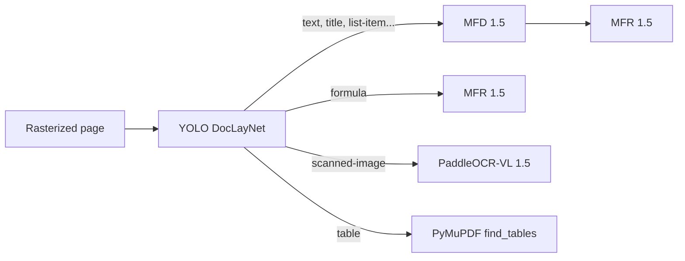

# Models

TexFromPDF combines several specialized models. None of them is trained in this repository.

| Model | Role | File / identifier | Origin | Loading |
|---|---|---|---|---|
| **YOLOv12l DocLayNet** | Layout analysis (block detection) | `models/layout_detection/yolov12l-doclaynet.pt` | YOLO model trained on DocLayNet | Local, via `ultralytics.YOLO` |
| **YOLO26m DocLayNet** | Lighter alternative for layout analysis | `models/layout_detection/yolo26m-doclaynet.pt` | same | Local (selected with `model_name`) |
| **MFD 1.5** (Mathematical Formula Detection) | Detects formulas inside a text block | `models/formula/pix2text-mfd-1.5.onnx` | [Pix2Text](https://github.com/breezedeus/pix2text) | Local, via `cnstd.yolo_detector.YoloDetector` |
| **MFR 1.5** (Mathematical Formula Recognition) | Formula image → LaTeX | `breezedeus/pix2text-mfr-1.5` | Hugging Face | Auto, `TrOCRProcessor` + `ORTModelForVision2Seq` (ONNX) |
| **PaddleOCR-VL 1.5** | Visual OCR of scanned areas | `PaddlePaddle/PaddleOCR-VL-1.5` | Hugging Face | Auto, `AutoModel` (`trust_remote_code=True`) |

## Where each model is used



- **YOLO DocLayNet**: run once per page, `conf=0.25`, on the 450 DPI image.
- **MFD**: run on every text block (except page headers/footers, whose native text is kept).
- **MFR**: run for each detected formula, either inline (through MFD) or isolated (`Formula` block).
- **PaddleOCR-VL**: only for blocks reclassified as `scanned-image`.
- **Tables**: no Deep Learning model; extraction by `PyMuPDF.find_tables` from the area located by YOLO.

## Choosing the layout model

```python
ContentExtractor(
    pdf_path="doc.pdf",
    output_dir="output",
    model_name="yolo26m-doclaynet.pt",   # file located in models/layout_detection/
)
```

## GPU handling

- The chosen device (`--device`) is passed to YOLO, MFD and PaddleOCR-VL; `ContentExtractor` falls back to CPU if CUDA is unavailable.
- `FormulaDetection` and `VlmImageRecognition` also fall back to CPU on their own if CUDA is requested but unavailable.
- PaddleOCR-VL is loaded in `bfloat16` on CUDA, in `float32` on CPU.
- `FormulaRecognition` (MFR) runs with ONNX Runtime on CPU by default.

## Available PaddleOCR-VL tasks

`VlmImageRecognition` exposes several prompts, even though only `ocr` is currently used by the pipeline:

| Task | Prompt |
|---|---|
| `ocr` | `OCR:` |
| `table` | `Table Recognition:` |
| `formula` | `Formula Recognition:` |
| `chart` | `Chart Recognition:` |
| `spotting` | `Spotting:` |
| `seal` | `Seal Recognition:` |

## Licenses

Check the license of each model before any commercial use. The TexFromPDF code is distributed under the license in the `LICENSE` file.
