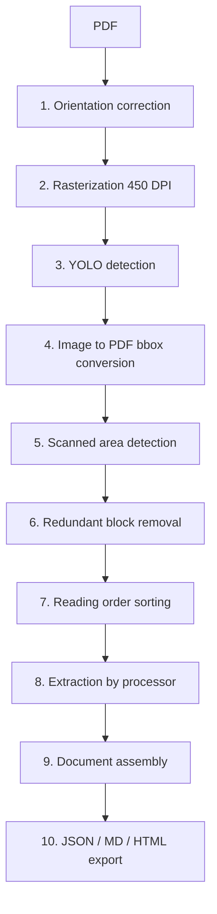

# Detailed pipeline

This document follows the processing of a PDF step by step, as implemented in `src/`.

## 1. Orientation correction

`ContentClassifier._correct_page_rotation()`:

1. **Text analysis** (`_detect_page_orientation`): the spans of `page.get_text("dict")` are counted according to the line direction vector (`dir`) — horizontal (0°), vertical (270°) or upside-down (180°). The majority direction wins.
2. **Projection fallback** (`_detect_page_orientation_by_projection`): if the text gives nothing (0°), the page is rendered in grayscale, binarized, and the variances of the horizontal and vertical projections are compared. A ratio > 1.2 means horizontal text; < 0.8 means the page must be rotated by 270°.
3. If a rotation is needed, `page.set_rotation()` is applied and the angle is stored in `_page_rotations`.

## 2. Rasterization

`_page_rasterization()` renders each page as an RGB PNG at **450 DPI** (`zoom = 450/72 = 6.25`) in `rasterized_pages/page_XXXX/`. A JSON metadata file is written next to it (image/PDF dimensions, rotation, DPI, scale, `is_scanned` flag).

## 3. Layout detection

`_classify_page()` runs the YOLO model (`yolov12l-doclaynet.pt` by default) with a confidence threshold of `conf=0.25`. The classes are those of **DocLayNet**:

`Caption`, `Footnote`, `Formula`, `List-item`, `Page-footer`, `Page-header`, `Picture`, `Section-header`, `Table`, `Text`, `Title`.

Each detection becomes a dictionary: `id`, `class_id`, `class_name`, `confidence`, `bbox_image`, `bbox_pdf`.

## 4. Coordinate conversion

`image_bbox_to_pdf()` divides by the scale and adds a margin (−5/+5 pt in x, −2/+2 pt in y). If the page was rotated, `transform_bbox_for_rotation()` brings the bbox back into the original page coordinate system.

## 5. Scanned area detection

`utils/scanned.py`:

- `is_scanned_image(page)` computes a score: +3 if the extractable text is shorter than 50 characters, +3 if images cover more than 85 % of the page. Score ≥ 5 → scanned page.
- `is_scanned_block(page, bbox, class_name)` applies the logic to a block (class names are compared in lowercase): for a picture, the page-level scanned test; for a table, no table found by PyMuPDF; for other classes, no text in the area.

A scanned block is reclassified as **`scanned-image`** and will be processed by the visual OCR (PaddleOCR-VL).

## 6. Redundant block removal

`correct_blocks_redundancy()` (`utils/bounding_box.py`) compares all blocks pairwise with a 10 pt tolerance:

- Two **superimposed** blocks (close corners) of the same class: only one is kept.
- Superimposed blocks of different classes: priority rules (a `Formula` wins over a text block; a non-image block wins over a superimposed image; a table wins over an image).
- A block **contained** in another one is removed.

The list of removed indices is stored in `removed_blocks`.

## 7. Reading order sorting

`sort_blocks_by_position()` sorts by `y_min`, groups blocks whose `y_min` differs by less than 10 pt into the same "line", then sorts each line by `x_min`. Blocks are thus ordered top to bottom, left to right.

> The sorting is intentionally simple: complex multi-column layouts may produce an imperfect reading order.

## 8. Extraction by processor

### Text — `TextProcessor`

1. Crop of the area image (zoom 2).
2. Native text extraction with `page.get_textbox()`.
3. Inline **formula detection** with the MFD model (`FormulaDetection`).
4. For page headers and footers, or if no formula is found: the native text is returned directly (`TextModel`).
5. Otherwise, for each detected formula: crop, LaTeX recognition by MFR (`FormulaRecognition`), then the matching fragment of the native text is replaced by `$latex$`.
6. The text is normalized (`normalize_text`): line breaks, tabs and multiple spaces are collapsed into a single space.

An alternative mode (`_use_bounding_box = True`, disabled by default) rebuilds the text from the text and formula bboxes and returns a `TextFormulaModel`.

### Formula — `MathProcessor`

Crops the area into an image, saves it in `predictions/page_XXXX/formula/`, then passes it to the MFR model. The result is a `TextModel` of class `Formula`, rendered in Markdown as `$$…$$`.

### Table — `TableProcessor`

1. `page.find_tables(rect, **table_settings)` (`lines` strategy by default, see [configuration.md](configuration.md)).
2. A debug image with the drawn tables and cells is saved.
3. Cleanup of the extracted matrix:
   - removal of entirely empty columns;
   - propagation of `None` cells (merged cells) from the left or from above;
   - removal of empty rows.
4. The result is a `TableModel` whose `structured_content` is a `list[list[str]]` matrix.
5. On export, `TableModel._convert_table_to_html()` **rebuilds the `rowspan`/`colspan`** by merging adjacent cells with identical content.

### Image — `ImageProcessor`

Crops the area (zoom 2) and encodes it as a base64 PNG in an `ImageModel`.

### Scanned image — `ScannedImageProcessor`

Crops the area, saves it in `predictions/page_XXXX/scanned_image/`, then passes it to `VlmImageRecognition` (PaddleOCR-VL-1.5, `ocr` task, `OCR:` prompt, at most 512 generated tokens).

## 9. Assembly

`LayoutBlockProcessor.process()` builds a `Document` (identifier = MD5 of the PDF file) containing one `Page` per page, each with its blocks. The result is written to `extracted_content.json`.

## 10. Export

- **JSON**: `Document.to_dict()`.
- **Markdown**: `Document.to_markdown()` → `Page.to_markdown()` → `block.to_markdown()`.
- **HTML**: same principle with `to_html()`.

| Block | Markdown | HTML |
|---|---|---|
| `title`, `section-header`, `page-header` | `## content` | `<h2>` (title, section-header) |
| `formula` | `$$content$$` | plain text |
| other text | content | content |
| table | HTML `<table>` | HTML `<table>` |
| image | `` | `` |

See [limitations.md](limitations.md) for the current limits of this behavior.
